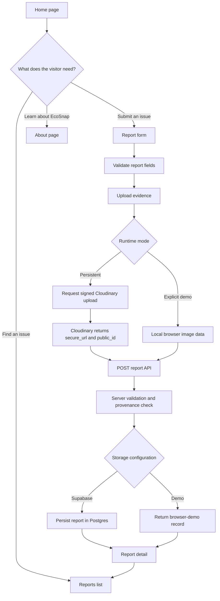
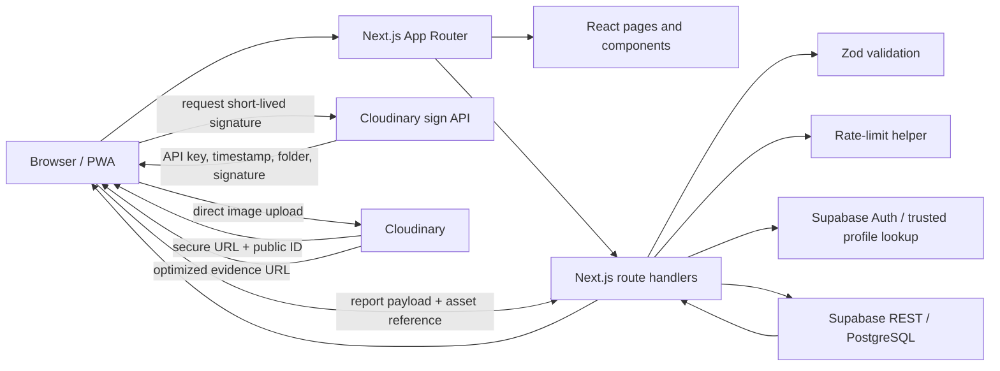
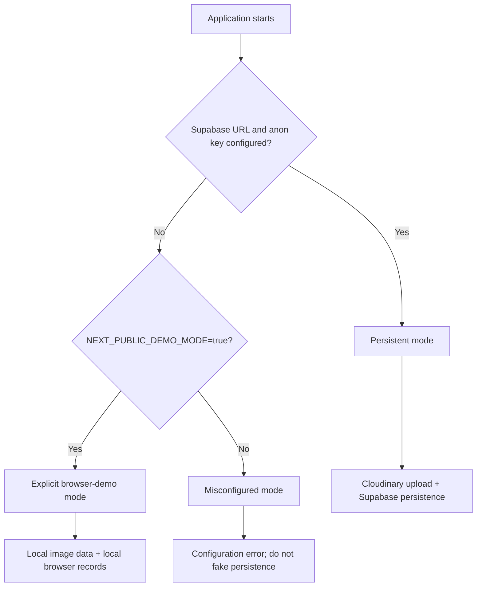
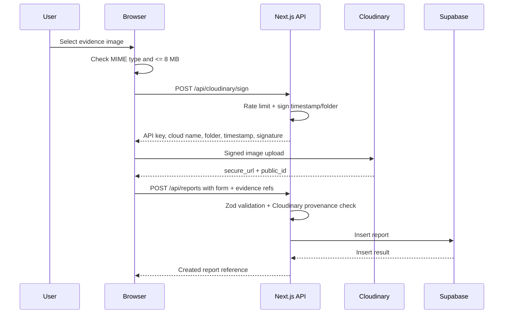
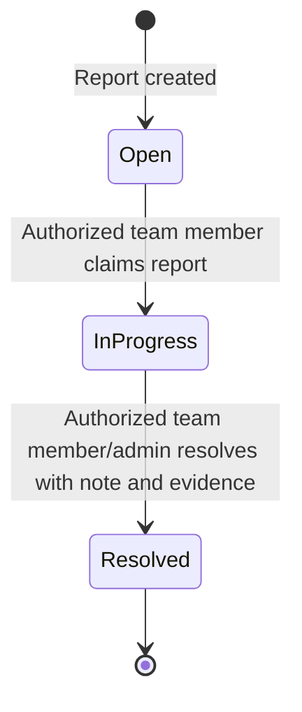
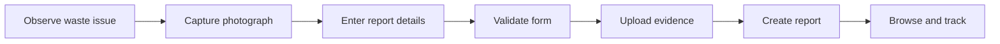
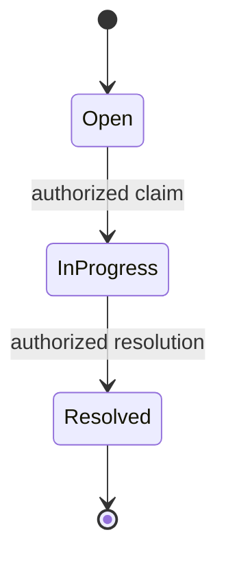
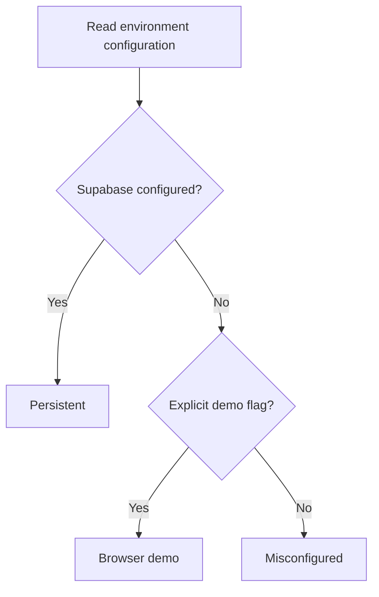

# EcoSnap — Evidence-led Campus Waste Reporting

[](https://nextjs.org/)
[](https://react.dev/)
[](https://www.typescriptlang.org/)
[](https://supabase.com/)
[](https://cloudinary.com/)
[](#license)

**EcoSnap** is an image-first campus waste reporting platform. It helps campus communities turn observations—overflowing bins, litter, plastic waste, recycling issues and illegal dumping—into structured reports with photographic evidence, a location, category, priority and a trackable status.

> **Current release:** the repository documents a deployed web application/PWA at [ecosnap-hacktober-hackdays.vercel.app](https://ecosnap-hacktober-hackdays.vercel.app). It is not a native Android/iOS application. The repository's own QA and implementation-status documents distinguish completed checks from pending or deferred capabilities; this README preserves those distinctions.

**Repository:** [FiREdeviL04/ECO-SNAP](https://github.com/FiREdeviL04/ECO-SNAP)  
**Live application:** [https://ecosnap-hacktober-hackdays.vercel.app](https://ecosnap-hacktober-hackdays.vercel.app)  
**Primary stack:** Next.js App Router, React, TypeScript, Zod, Cloudinary, Supabase, Vercel.

---

## Contents

- [At a glance](#at-a-glance)
- [Problem and solution](#problem-and-solution)
- [Product capabilities](#product-capabilities)
- [Application walkthrough](#application-walkthrough)
- [Architecture](#architecture)
- [Core workflows](#core-workflows)
- [Data model and status lifecycle](#data-model-and-status-lifecycle)
- [Security and authorization](#security-and-authorization)
- [Technology stack](#technology-stack)
- [Getting started](#getting-started)
- [Environment variables](#environment-variables)
- [Supabase setup and migrations](#supabase-setup-and-migrations)
- [API reference](#api-reference)
- [Quality assurance and verification](#quality-assurance-and-verification)
- [Known limitations and roadmap](#known-limitations-and-roadmap)
- [Project structure](#project-structure)
- [Competition demo guide](#competition-demo-guide)
- [Contribution guide](#contribution-guide)
- [License](#license)
- [References](#references)

---

## At a glance

| Area | Description |
|---|---|
| Product | Evidence-led campus waste reporting |
| Primary users | Campus community members; authenticated team members and administrators for role-aware workflows |
| Report categories | Overflowing bin, Litter, Plastic waste, Recycling issue, Illegal dumping, Other |
| Priority | Low, Medium, High |
| Report states | Open, In Progress, Resolved |
| Evidence | Image upload using signed Cloudinary uploads in persistent mode |
| Persistence | Supabase REST/Postgres in persistent mode; explicitly enabled browser-only demo mode for demos |
| Discovery | Server-backed search, category/status/priority filters and bounded pagination |
| Personal area | Sign-in and a user dashboard for own reports |
| Team workflow | Team-member application and report-claim workflow foundation |
| Delivery | Installable, mobile-first Progressive Web App (PWA) |

### Release facts and evidence labels

The implementation and QA status recorded in the repository are the source for the claims in this README. In particular:

- **Verified in the repository's release QA report:** typecheck, automated tests, production build, deployed runtime mode, reports API, and the documented production report workflow.
- **Verified with caveats:** lint passed with non-blocking warnings; authorization/RBAC foundation exists, but full authenticated role and policy verification remains gated.
- **Deferred:** full report administration/status-management UI, resolution evidence UI, maps and AI-assisted labels.
- **Not run / not supplied:** device/emulator automation, full keyboard/screen-reader assessment and some production-origin checks.

See [`docs/IMPLEMENTATION_STATUS.md`](docs/IMPLEMENTATION_STATUS.md), [`docs/QA_REPORT.md`](docs/QA_REPORT.md), [`docs/RBAC_STATUS.md`](docs/RBAC_STATUS.md) and [`docs/BASELINE_AUDIT.md`](docs/BASELINE_AUDIT.md) for detailed evidence and caveats.

---

## Problem and solution

Campus cleanliness issues are often communicated informally. A short message without a photo, precise location or structured priority can make it difficult to understand the problem, route it to the right people and track whether it has been addressed.

EcoSnap structures that process:

1. A person notices a waste or cleanliness issue.
2. They upload a photograph and describe the issue.
3. The application validates the report and its evidence reference.
4. The report is stored and becomes discoverable.
5. Users can find the report and inspect its current status.
6. Role-aware workflow capabilities provide a foundation for team assignment and resolution actions, subject to the activation gates described below.

### Intended value

- **Context:** an image and location accompany the report.
- **Consistency:** categories and priority levels make reports easier to interpret.
- **Visibility:** reports can be browsed, searched and filtered.
- **Traceability:** each report receives a unique identifier and creation timestamp.
- **Accountability foundation:** authenticated roles and team workflows are represented in the codebase and database migration, with production activation and verification requirements documented separately.

EcoSnap is a reporting and workflow tool. It does not independently certify that a cleanup occurred, measure waste weight, or prove environmental impact unless evidence and measurement processes are added and verified.

---

## Product capabilities

### 1. Public landing page (`/`)

- Explains the product's evidence-to-action workflow.
- Provides calls to action to submit a report or browse existing reports.
- Requests report metrics from the reports API.
- Displays a clear unavailable state when live metrics cannot be loaded rather than inventing values.

### 2. Submit a report (`/report`)

A report contains:

| Field | Validation / allowed values |
|---|---|
| Title | Trimmed; 4–100 characters |
| Description | Trimmed; 10–600 characters |
| Category | One of the six supported categories |
| Location | Trimmed; 2–100 characters |
| Severity | Low, Medium or High |
| Evidence URL | HTTPS Cloudinary asset in persistent mode; image data URL only in explicit demo mode |
| Cloudinary public ID | Required; demo records use a `demo/` identifier |

Additional behavior:

- Accepted browser upload MIME types: JPEG, PNG, WebP and GIF.
- Maximum client-side file size: 8 MB.
- Persistent mode requests a server-generated signature and uploads directly to Cloudinary.
- A report cannot be submitted until the upload response contains a `secure_url` and `public_id`.
- The API validates the report again on the server.
- The server sets the initial status to `Open`, and generates the report ID and timestamp.
- Submission errors are surfaced; a failed database write is not reported as a successful submission.

**Demo mode:** when `NEXT_PUBLIC_DEMO_MODE=true` and Supabase is not configured, the browser can keep image data and reports locally. This is for demonstration only: records are not shared with other browsers or users. It is not persistent production storage.

### 3. Browse reports (`/reports`)

- Server-backed search across title, description and location.
- Category, status and priority filters.
- Apply and clear filter actions.
- Result totals and bounded pagination.
- Loading, empty, no-match and service-error states.
- In demo mode, reads browser-local records and is limited to that browser.

### 4. Report details (`/reports/[id]`)

- Shows evidence image, title, category, location, priority, status, reference and creation date.
- Supports returning to the previous report search/filter URL when it is a valid internal `/reports` path.
- Differentiates a loading state, a service error and a confirmed missing record.
- Does not expose Cloudinary API secrets. The public asset identifier is persisted for application use.

### 5. About (`/about`)

Explains the evidence-first approach and the campus reporting problem.

### 6. Authentication and personal dashboard

- `/login` supports account registration and sign-in through the application's Supabase Auth API route.
- `/dashboard` requests the signed-in user's own reports and shows personal report counts.
- Session tokens are stored in HTTP-only cookies by the server-side authentication route.
- Application roles are looked up from the trusted `profiles` table; a role submitted by the browser is not treated as authoritative.

The complete production role rollout still has explicit migration, administrator-bootstrap and test-identity gates. Refer to [RBAC status](docs/RBAC_STATUS.md).

### 7. Team-member and administrator surfaces

- `/team-member`: application form for a normal user seeking team-member access.
- `/team`: team workload surface with a report claim action.
- `/admin`: protected team application review surface.
- API/database workflows include atomic report claiming, evidence-backed resolution RPC support and administrator application review.

**Important limitation:** the current QA notes state that resolution-upload UI, full report administration, audit views and live authenticated role/RLS tests are not yet fully verified. The existence of a route or SQL function is not proof that every end-to-end role workflow is production-ready. Apply and verify migration `002_rbac_workflow.sql`, bootstrap an administrator safely, and test with controlled identities before relying on privileged workflows.

---

## Application walkthrough



### Main route map

| Route | Purpose | Access intent |
|---|---|---|
| `/` | Product landing page and live metrics | Public |
| `/report` | Submit a waste report | Public in baseline flow; authenticated creation can be required when RBAC is enabled |
| `/reports` | Search and browse reports | Public |
| `/reports/[id]` | Inspect one report | Public |
| `/about` | Product explanation | Public |
| `/login` | Register / sign in | Public |
| `/dashboard` | Own reports and personal metrics | Authenticated user |
| `/team-member` | Apply for team role | Authenticated normal user |
| `/team` | Claim eligible work | Team member / admin |
| `/admin` | Review team applications | Admin |

The route/API permission matrix is maintained in [`docs/ROUTE_PERMISSION_MATRIX.md`](docs/ROUTE_PERMISSION_MATRIX.md).

---

## Architecture

EcoSnap uses a Next.js App Router application with server route handlers. The browser performs the image transfer directly to Cloudinary after obtaining a signature from the EcoSnap server. Report data is sent to the EcoSnap API, which validates the payload and uses Supabase REST in persistent mode.



### Architecture decisions

- **Next.js App Router:** one codebase hosts application pages and server-side API endpoints.
- **Zod:** shared schema provides consistent report validation in the form and API.
- **Cloudinary signed uploads:** the API secret remains on the server; the browser receives only the upload parameters required for a signed upload.
- **Supabase REST:** structured report and workflow data is stored in Postgres; Auth provides identities and sessions.
- **Explicit runtime modes:** persistent, demo and misconfigured modes are distinguished. Browser-only persistence is not silently used when a persistent API request fails.
- **PWA:** installable web experience; it is not a native application.

### Runtime modes



The current `lib/runtime.ts` returns `persistent` when both Supabase public configuration variables are present, `demo` only when the explicit demo flag is true and Supabase is absent, and `misconfigured` otherwise.

---

## Core workflows

### Cloudinary evidence upload

1. The user selects an image.
2. The client checks the declared MIME type and file size (8 MB maximum).
3. In persistent mode, the client requests `POST /api/cloudinary/sign`.
4. The server checks configuration and rate limits the signing request.
5. The server generates a timestamp and SHA-1 signature using the configured folder and server-only API secret.
6. The browser uploads the file directly to the Cloudinary image upload endpoint.
7. The client checks that the response succeeded and includes both `secure_url` and `public_id`.
8. The report form includes these returned values in the report request.
9. The report API validates the image asset against the configured Cloudinary cloud and upload folder before persistence.



**Security note:** Cloudinary API secret must never be placed in client-side code, committed to the repository or exposed in a public README. The browser upload signature is a limited, time-bound signing artifact; it is not the account secret.

### Report lifecycle



The repository's RBAC SQL defines status-history support and RPCs for claiming and resolving reports. The UI/API/DB release status is documented with caveats in `docs/RBAC_STATUS.md` and `docs/QA_REPORT.md`.

---

## Data model and status lifecycle

### Report record

The main `reports` table is created in `supabase/migrations/001_create_reports.sql` and extended by `002_rbac_workflow.sql`.

| Field (application meaning) | Purpose |
|---|---|
| `id` | UUID report reference, generated server-side |
| `title` | Short issue title |
| `description` | Longer issue context |
| `category` | Controlled waste issue category |
| `location` | Campus location description |
| `severity` | Low / Medium / High |
| `status` | Open / In Progress / Resolved |
| `image_url` | Evidence URL |
| `cloudinary_public_id` | Cloudinary asset reference |
| `created_at` | Creation timestamp |
| `updated_at` | Last update timestamp, maintained by database trigger |
| `reporter_id` | Authenticated reporter identity when RBAC workflow is enabled |
| `assigned_to` | Team member assigned to an issue in the RBAC workflow |
| resolution fields | Resolution note, evidence URL/public ID, resolution actor/time where migration is applied |

### Supporting RBAC/workflow tables

The second migration introduces trusted application profiles/roles, team member applications, report status history and administrator audit logging. The migration file is the canonical source for the exact columns, constraints and function signatures.

### Category values

- `Overflowing bin`
- `Litter`
- `Plastic waste`
- `Recycling issue`
- `Illegal dumping`
- `Other`

### Severity values

- `Low`
- `Medium`
- `High`

### Status values

- `Open`
- `In Progress`
- `Resolved`

---

## Security and authorization

Security behavior is enforced at the API and database layers, not only by hiding controls in the UI.

### Implemented security foundations

- Server-side report validation using Zod.
- Controlled malformed-JSON responses for report creation and authentication routes.
- HTTPS/Cloudinary asset provenance validation for persistent report creation.
- Cloudinary API secret remains server-side.
- Rate limiting exists for Cloudinary signing, report creation and authentication attempts.
- Session cookies are HTTP-only; production cookies are secure and use `SameSite=Lax`.
- Trusted application roles are read from the Supabase `profiles` table; browser-supplied role values are not accepted as authority.
- Supabase Row Level Security is enabled by the migrations.
- Anonymous report update/delete permissions are revoked in the base migration.
- Sensitive team and admin APIs check the authenticated user's role.
- Team claim and resolution actions use database RPC functions with authorization checks.

### Rate-limit deployment caveat

`lib/rate-limit.ts` uses an in-memory `Map`. This is useful as a local/basic per-process safeguard but is not a distributed rate limiter. In serverless or multi-instance production deployments, the buckets may not be shared across instances or survive restarts. Use an external/distributed rate-limit provider before treating the limits as a production abuse-control boundary.

### RBAC activation gate

The repository documents this controlled sequence:

1. Apply `supabase/migrations/002_rbac_workflow.sql` after the base migration.
2. Create the initial administrator using a controlled database operation; never expose public admin bootstrap.
3. Configure test identities for normal user, team member and administrator.
4. Confirm Supabase Auth settings and migration success.
5. Configure `ECOSNAP_RBAC_ENABLED=true` in the target environment.
6. Redeploy, refresh sessions and verify authenticated APIs and RLS policies using each role.

Do not infer that all RBAC paths are fully tested merely because the migration or UI routes exist. The repository's QA report explicitly distinguishes foundation/build verification from live authenticated-role verification.

See:
- [`docs/RBAC_STATUS.md`](docs/RBAC_STATUS.md)
- [`docs/ROUTE_PERMISSION_MATRIX.md`](docs/ROUTE_PERMISSION_MATRIX.md)
- [`docs/QA_REPORT.md`](docs/QA_REPORT.md)

---

## Technology stack

| Technology | Role in EcoSnap |
|---|---|
| Next.js 16 (App Router) | Web framework, routing, server endpoints |
| React 19 | Interactive user interface |
| TypeScript | Static typing |
| Zod | Runtime validation of request and form data |
| Lucide React | Interface icons |
| Cloudinary | Signed image upload, media storage and delivery |
| Supabase Auth | User authentication and session identity |
| Supabase PostgreSQL | Reports, profile roles and workflow records |
| Vercel | Production hosting |
| PWA metadata/manifest | Installable mobile-first web experience |
| Node.js test runner | Focused automated tests |
| ESLint | Static code linting |

Exact dependency versions are maintained in `package.json` and `package-lock.json`.

---

## Getting started

### Prerequisites

- Node.js compatible with the Next.js version in `package.json` (use a current supported LTS release).
- npm.
- A Cloudinary account for persistent image uploads.
- A Supabase project for persistent report storage and authentication.
- Git.

### Clone the repository

```bash
git clone https://github.com/FiREdeviL04/ECO-SNAP.git
cd ECO-SNAP
```

### Install dependencies

```bash
npm ci
```

### Configure environment variables

```bash
cp .env.example .env.local
```

On Windows PowerShell:

```powershell
Copy-Item .env.example .env.local
```

Fill in the values described in [Environment variables](#environment-variables). Never commit `.env.local`.

### Apply database migrations

Apply `supabase/migrations/001_create_reports.sql` in the Supabase SQL Editor for the core report table. Apply `002_rbac_workflow.sql` only when you are intentionally enabling the role-aware workflows and have reviewed its activation runbook.

### Run the development server

```bash
npm run dev
```

Open [http://localhost:3000](http://localhost:3000).

### Try the report flow

1. Open `/report`.
2. Select an accepted image.
3. Complete the report title, category, location, priority and description.
4. Wait for the upload to complete.
5. Submit the report.
6. Open `/reports` and the newly created report detail page.

For a real persistent integration, configure Cloudinary and Supabase. For an isolated local demo only, explicitly set `NEXT_PUBLIC_DEMO_MODE=true` and leave Supabase unconfigured. Demo records remain in the current browser and do not become shared production records.

---

## Environment variables

Copy `.env.example` to `.env.local` and configure only the variables appropriate to the mode you are running.

| Variable | Required | Description | Exposure |
|---|---|---|---|
| `NEXT_PUBLIC_CLOUDINARY_CLOUD_NAME` | Persistent media | Cloudinary cloud name used by the browser upload endpoint and server asset validation | Public identifier; not a secret |
| `CLOUDINARY_API_KEY` | Persistent media | Cloudinary API key included in the signed upload request | Server config; upload response exposes key as needed |
| `CLOUDINARY_API_SECRET` | Persistent media | Secret used to generate the upload signature | **Server only; never `NEXT_PUBLIC_`** |
| `CLOUDINARY_UPLOAD_FOLDER` | Recommended | Dedicated folder for EcoSnap report evidence; defaults to `ecosnap/reports` in code | Non-secret |
| `NEXT_PUBLIC_SUPABASE_URL` | Persistent storage/auth | Supabase project URL | Public project endpoint |
| `NEXT_PUBLIC_SUPABASE_ANON_KEY` | Persistent storage/auth | Supabase anon/publishable client key, subject to RLS | Public client key; security depends on RLS and API authorization |
| `NEXT_PUBLIC_DEMO_MODE` | Optional | Must be `true` to enable browser-only demo mode when Supabase is not configured | Public mode flag |
| `ECOSNAP_RBAC_ENABLED` | Optional; only after rollout gate | Enables stricter role-aware report creation/dashboard behavior and related workflows | Server only |

Example `.env.local` shape (values intentionally omitted):

```dotenv
NEXT_PUBLIC_CLOUDINARY_CLOUD_NAME=
CLOUDINARY_API_KEY=
CLOUDINARY_API_SECRET=
CLOUDINARY_UPLOAD_FOLDER=ecosnap/reports

NEXT_PUBLIC_SUPABASE_URL=
NEXT_PUBLIC_SUPABASE_ANON_KEY=
NEXT_PUBLIC_DEMO_MODE=false

ECOSNAP_RBAC_ENABLED=false
```

### Runtime configuration rules

| Supabase URL + key | Demo flag | Runtime result |
|---|---|---|
| Present | Any value | `persistent` |
| Absent | `true` | `demo` |
| Absent | Not `true` | `misconfigured` |

If runtime mode is misconfigured, the application should surface configuration errors; it must not silently claim that reports were saved.

---

## Supabase setup and migrations

### Migration order

1. `supabase/migrations/001_create_reports.sql` — report table, enums, constraints, indexes, timestamps and RLS baseline.
2. `supabase/migrations/002_rbac_workflow.sql` — application roles, profiles, team member applications, assignments, status history, audit information, policy/function definitions and workflow RPCs.

### Operational cautions

- Review the complete SQL migration before applying it to a production database.
- Apply migrations in order.
- Do not create an administrator through public registration.
- Use a controlled bootstrap operation to set the first trusted administrator.
- Verify table grants and RLS behavior with anonymous and authenticated test users.
- Test that anonymous users cannot update or delete reports.
- Test role boundaries: normal users must not claim reports or review applications; team members must not perform administrator-only actions; administrators must be authorized for review actions.
- Only enable the RBAC flag after the migration and test identities are ready.

### Recommended live verification matrix

| Actor | Read public reports | Read own dashboard | Apply for team role | Claim report | Resolve assigned report | Review applications |
|---|---:|---:|---:|---:|---:|---:|
| Anonymous | Yes | No | No | No | No | No |
| Normal user | Yes | Yes | Yes | No | No | No |
| Team member | Yes | Yes | No / role-dependent | Yes | Assigned work | No |
| Admin | Yes | Yes | No / role-dependent | Yes | Authorized workflow | Yes |

The exact permission rules are defined in the current migration and route permission matrix; use the matrix above as a test plan and reconcile it with the deployed policy version before release.

---

## API reference

The primary endpoints discovered in the repository are listed below. Request schemas and response codes should be checked against the corresponding route handlers when maintaining the API.

| Method | Endpoint | Purpose |
|---|---|---|
| `GET` | `/api/runtime` | Reports `persistent`, `demo` or `misconfigured` runtime mode |
| `POST` | `/api/cloudinary/sign` | Returns signed Cloudinary upload parameters when configured |
| `GET` | `/api/reports` | Lists reports; supports search, filters, pagination, metrics and optional authenticated scopes |
| `POST` | `/api/reports` | Validates and creates a report |
| `POST` | `/api/auth` | Register, login, logout and current-session (`me`) actions |
| `GET` | `/api/team-applications` | Lists applications according to authenticated role |
| `POST` | `/api/team-applications` | Submit a team-member application |
| `POST` | `/api/team/claim` | Claims an open report through the database workflow RPC |
| `POST` | `/api/team/resolve` | Submits resolution details and Cloudinary evidence via workflow RPC |
| `POST` | `/api/admin/applications/[id]` | Administrator approves/rejects a team-member application |

### Reports query parameters

The `GET /api/reports` implementation reads the following query parameters:

| Parameter | Purpose |
|---|---|
| `id` | Restrict result to one report ID |
| `search` | Search title, description and location (bounded to 100 characters) |
| `category` | Filter category |
| `status` | Filter status |
| `severity` | Filter priority |
| `page` | Bounded page number |
| `pageSize` | Bounded page size (maximum 50) |
| `scope=mine` | Authenticated user's reports when RBAC is enabled |
| `scope=team` | Team-scoped reports for team member/admin when enabled |

Persistent report responses include the persistence mode, report collection, pagination totals and status metrics. Exact response shapes are defined in `app/api/reports/route.ts`.

### Error handling

The API uses structured error objects with stable codes for important cases, including:

- `CONFIGURATION_ERROR`
- `INVALID_JSON`
- `VALIDATION_ERROR`
- `INVALID_ASSET`
- `RATE_LIMITED`
- `AUTHENTICATION_REQUIRED`
- `FORBIDDEN`
- `UPSTREAM_FAILURE`

Clients should distinguish configuration failures, validation failures, authorization failures, missing records and upstream service failures.

---

## Charts and figures

The following diagrams are generated from the described application behavior and architecture, not from fabricated usage statistics.

### Figure 1 — End-to-end report journey



### Figure 2 — Technology responsibility map

| Layer | Technology | Responsibility |
|---|---|---|
| Experience | Next.js + React | Routes and interactive UI |
| Validation | Zod | Runtime payload validation |
| Media | Cloudinary | Image upload/storage/delivery |
| Data | Supabase Postgres | Report and workflow records |
| Identity | Supabase Auth | Account/session management |
| Authorization | Trusted profile roles + RLS + API guards | Restricted actions |
| Hosting | Vercel | Production web hosting |

### Figure 3 — Report status lifecycle



### Figure 4 — Runtime mode decision



### Quantitative figures

No usage or impact chart is included because this repository snapshot does not provide a trustworthy dataset of report volumes, resolution times, waste weight, user counts or environmental impact. The homepage metrics are sourced from persisted report records when the API returns them. Once a real dataset is available, charts can be added for:

- Reports by status
- Reports by category
- Reports by priority
- Report creation trend over time
- Median time to resolution (only after trustworthy status-history timestamps are collected)

Do not fill these charts with invented values.

---

## Quality assurance and verification

### Commands

```bash
npm run lint
npm run typecheck
npm test
npm run build
```

### Repository-reported latest QA snapshot

The following table reflects `docs/QA_REPORT.md` in the repository snapshot inspected for this README. It is not a new test run performed during README generation.

| Check | Repository QA result | Notes |
|---|---|---|
| Strict TypeScript | Pass | `npm run typecheck` |
| ESLint | Pass with warnings | Four non-blocking image/config and browser-mapping warnings were recorded |
| Focused automated tests | Pass | `npm test` using Node test runner |
| Production build | Pass | `npm run build` |
| Cloudinary missing-config behavior | Pass | Local signing endpoint returns safe `503 CONFIGURATION_ERROR` without credentials |
| Search/filter/pagination | Pass | Server query parameters, bounded page handling and UI states documented |
| Real Cloudinary report flow | Pass, as reported | QA report says production report flow was verified with a real Cloudinary asset and provider public ID |
| Supabase persistence | Pass, as reported | Production reports endpoint returned persisted Supabase records |
| Production deployment | Pass, as reported | Vercel deployment reported READY; homepage and runtime endpoint returned HTTP 200 |
| Production runtime mode | Pass, as reported | `/api/runtime` returned `persistent` |
| Reports API | Pass, as reported | Production endpoint returned HTTP 200 with Supabase persistence and metrics |
| Anonymous update/delete denial | Migration evidence | Live role/policy coverage still needs controlled testing |
| Full authenticated RBAC | Partial / activation-gated | Migration and route foundation exist; complete live role test with identities not run |
| Device/accessibility automation | Not run | Manual 360 px, keyboard, screen-reader and contrast review recommended |
| Admin resolution interface | Deferred | Do not present as complete |
| Resolution evidence UI | Deferred | Workflow/database support exists; UI is not complete |
| Maps and AI labels | Deferred | Not part of the verified core release |

### Smoke test checklist

- [ ] Open the deployed homepage and confirm metrics are live or visibly unavailable.
- [ ] Open `/report`; test each required field and invalid input.
- [ ] Upload a real supported image and confirm Cloudinary returns `secure_url` and `public_id`.
- [ ] Submit a report and confirm a single database record is created.
- [ ] Open `/reports` in a fresh browser session and find the report.
- [ ] Search by title, description and location.
- [ ] Apply each category, status and priority filter; clear filters.
- [ ] Test pagination with enough records to create multiple pages.
- [ ] Open the report details and verify reference/date/evidence.
- [ ] Force a service/API failure and confirm it is not displayed as an empty success state.
- [ ] Test explicit demo mode separately; confirm demo records do not appear as shared persistent records.
- [ ] Test anonymous attempts to update/delete database records.
- [ ] Verify role boundaries using controlled normal-user, team-member and admin test identities before enabling the complete privileged workflow.
- [ ] Review at 360 px, 390 px, tablet and desktop widths; test keyboard focus and contrast.

---

## Known limitations and roadmap

The current repository deliberately avoids presenting incomplete capabilities as finished.

| Capability | Status recorded in repository | Next step |
|---|---|---|
| Core report create/list/detail | Implemented; production flow reported verified | Continue regression testing |
| Cloudinary signed uploads | Implemented; real production upload reported verified | Add ongoing provider/error monitoring and distributed abuse controls |
| Supabase persistent reports | Implemented; production endpoint reported verified | Continue RLS regression and backup/retention review |
| Search/filter/pagination | Implemented | Add sort only if product requirements justify it |
| User authentication/dashboard | Foundation and surfaces implemented | Verify end-to-end sessions, email settings and role data |
| Team application/claim workflow | Foundation/API/SQL present | Run authenticated role tests after migration gate |
| Full admin report management | Deferred / incomplete | Design and implement secure moderation UI and audit views |
| Resolution evidence UI | Deferred / incomplete | Build verified before/after upload and display flow |
| Maps | Deferred | Define location precision, consent and map provider first |
| AI-assisted labels | Deferred | Define model, privacy, accuracy evaluation and manual override before implementation |
| Native mobile app | Not present | Current delivery is a PWA; assess native app only if a requirement emerges |
| Distributed rate limiting | Not present | Replace in-memory limiter for multi-instance production |
| Full device/accessibility automation | Not run | Add automated and manual test coverage |

### Explicit non-claims

EcoSnap does not currently claim:

- A native Android or iOS application.
- Fully verified production RBAC for every role/action.
- A complete admin report-management interface.
- A completed resolution-evidence user interface.
- AI-based waste recognition or automatic categorization.
- Map-based reporting or duplicate detection.
- Quantified environmental impact or independently verified cleanup outcomes.

---

## Project structure

The following is a high-level map of the main source directories. The repository may contain additional generated/configuration files.

```text
ECO-SNAP/
├── app/
│   ├── page.tsx                     # Home and campus metrics
│   ├── about/page.tsx               # About EcoSnap
│   ├── report/page.tsx              # Report creation route
│   ├── reports/page.tsx             # Searchable/filterable report list
│   ├── reports/[id]/page.tsx        # Report details
│   ├── login/page.tsx               # Sign-in and registration
│   ├── dashboard/page.tsx           # User dashboard
│   ├── team-member/page.tsx         # Team-member application
│   ├── team/page.tsx                # Team workload
│   ├── admin/page.tsx               # Admin application review
│   └── api/                         # Server-side route handlers
├── components/
│   ├── report-form.tsx
│   └── runtime-banner.tsx
├── lib/
│   ├── auth.ts                      # Session and trusted role lookup
│   ├── rate-limit.ts                # In-memory rate-limit helper
│   ├── report.ts                    # Shared schemas and asset validation
│   └── runtime.ts                   # Persistent/demo/misconfigured mode
├── supabase/
│   └── migrations/
│       ├── 001_create_reports.sql
│       └── 002_rbac_workflow.sql
├── tests/
│   └── validation.test.mjs
├── docs/
│   ├── BASELINE_AUDIT.md
│   ├── COMPETITION_DEMO.md
│   ├── FR_TRACEABILITY.md
│   ├── IMPLEMENTATION_STATUS.md
│   ├── ISO_READINESS.md
│   ├── QA_REPORT.md
│   ├── RBAC_STATUS.md
│   └── ROUTE_PERMISSION_MATRIX.md
├── public/
│   └── icon.svg
├── .env.example
├── package.json
└── README.md
```

---

## Competition demo guide

A focused demonstration should prove the primary product journey rather than listing every planned feature.

### Suggested 2-minute flow

| Time | What to show | What it demonstrates |
|---|---|---|
| 0:00–0:15 | Problem and EcoSnap landing page | Clear social problem and product purpose |
| 0:15–0:35 | Open report form | Structured report capture |
| 0:35–0:55 | Upload a real waste photograph | Cloudinary media integration |
| 0:55–1:15 | Submit report | Validation and persistence |
| 1:15–1:35 | Search/filter reports | Discovery and operational visibility |
| 1:35–1:50 | Open report detail | Traceable evidence and metadata |
| 1:50–2:00 | Architecture and next steps | Technical choices and credible roadmap |

### Demo preparation

- Use a clean, real example photograph that the team has permission to use.
- Confirm the production site is reachable before recording/presenting.
- Confirm Cloudinary and Supabase are in persistent mode.
- Check the reports list for diagnostic/test records and remove or clearly identify them if appropriate and authorized.
- Keep a short screen recording as a backup.
- Do not demonstrate an admin/team workflow unless the test identities, migration and authorization gates have been completed.
- Never show environment secrets or account dashboards containing sensitive credentials.

For more detail, see [`docs/COMPETITION_DEMO.md`](docs/COMPETITION_DEMO.md).

---

## Contribution guide

Contributions should preserve the architecture and security boundaries described above.

1. Fork the repository and create a focused feature branch.
2. Install dependencies with `npm ci`.
3. Make changes in small, reviewable commits.
4. Add or update tests for behavior changes, especially validation, API errors, role boundaries and runtime modes.
5. Run the repository checks:

   ```bash
   npm run lint
   npm run typecheck
   npm test
   npm run build
   ```

6. Document schema changes as a new ordered Supabase migration; do not rewrite an already-applied migration without a controlled migration plan.
7. Never commit `.env.local`, API secrets, production tokens or personal user data.
8. Open a pull request describing the change, test evidence, migration impact and any rollout requirements.

### Suggested engineering principles

- Validate on the server even when the client validates first.
- Never confuse an empty list with a failed API request.
- Do not trust a client-supplied role or report status transition.
- Use Cloudinary asset provenance checks for persistent evidence.
- Avoid unbounded list queries; preserve pagination limits.
- Use real records for metrics and label demo fixtures.
- Treat accessibility, error states and mobile layouts as product requirements.

---

## License

A license file was not present in the repository tree at the time this README was prepared. Until a `LICENSE` file is added, do not assume that the project is open-source under a particular license or that reuse rights are granted. Add the license selected by the repository owner and update this section.

---

## References

### Project resources

- [EcoSnap GitHub repository](https://github.com/FiREdeviL04/ECO-SNAP)
- [EcoSnap live application](https://ecosnap-hacktober-hackdays.vercel.app)
- [Baseline audit](docs/BASELINE_AUDIT.md)
- [Implementation status](docs/IMPLEMENTATION_STATUS.md)
- [QA report](docs/QA_REPORT.md)
- [Functional requirement traceability](docs/FR_TRACEABILITY.md)
- [RBAC status and activation runbook](docs/RBAC_STATUS.md)
- [Route and permission matrix](docs/ROUTE_PERMISSION_MATRIX.md)
- [Competition demo guide](docs/COMPETITION_DEMO.md)
- [ISO readiness notes](docs/ISO_READINESS.md)

### Technology documentation

- [Next.js Documentation](https://nextjs.org/docs)
- [React Documentation](https://react.dev/learn)
- [TypeScript Documentation](https://www.typescriptlang.org/docs/)
- [Zod Documentation](https://zod.dev/)
- [Cloudinary Documentation](https://cloudinary.com/documentation)
- [Cloudinary image upload](https://cloudinary.com/documentation/image_upload_api_reference)
- [Cloudinary image transformations](https://cloudinary.com/documentation/image_transformations)
- [Supabase Documentation](https://supabase.com/docs)
- [Supabase Row Level Security](https://supabase.com/docs/guides/database/postgres/row-level-security)
- [Supabase Auth](https://supabase.com/docs/guides/auth)
- [Vercel Documentation](https://vercel.com/docs)
- [Mermaid Documentation](https://mermaid.js.org/intro/)

---

<p align="center">
  <strong>EcoSnap</strong><br/>
  <em>See the problem. Report it. Make campus cleaner.</em>
</p>

---

## Research and design rationale

### Why evidence-first reporting?

A waste report is most actionable when it includes enough context for another person to understand and locate the issue. EcoSnap therefore makes a photograph, a human-readable location, a concise description and a controlled category/priority part of the report rather than treating an image as an optional attachment. This is a product-design rationale, not a measured claim that EcoSnap has reduced waste or response times.

### Why a media delivery platform?

The product displays user-submitted images in the form, report list and report detail views. A dedicated media platform separates image handling from the structured report database and provides secure upload and image delivery capabilities. EcoSnap uses Cloudinary for this media layer and stores the returned asset references with the report.

### Why explicit runtime modes?

Persistent storage and browser-local demo data have different reliability and visibility properties. A report saved in `localStorage` is not shared with another browser, device or campus operator. EcoSnap therefore distinguishes persistent, explicit demo and misconfigured modes so the UI can communicate what actually happened.

### Why defer advanced features?

Features such as maps, automated classification and advanced administration introduce new privacy, authorization, evidence and operational requirements. They are deliberately separated from the core reporting workflow so they do not weaken the reliability of image submission, persistence and report discovery.

---

## Figure index

| Figure | Description | Where to find it |
|---|---|---|
| 1 | Application walkthrough | [Application walkthrough](#application-walkthrough) |
| 2 | System architecture | [Architecture](#architecture) |
| 3 | Cloudinary report submission sequence | [Core workflows](#core-workflows) |
| 4 | Report status lifecycle | [Data model and status lifecycle](#data-model-and-status-lifecycle) |
| 5 | Runtime mode decision | [Architecture](#architecture) |
| 6 | Technology responsibility map | [Charts and figures](#charts-and-figures) |

## Article / presentation summary

**EcoSnap: Turning Campus Waste Observations into Evidence-backed Action**

EcoSnap is a campus-focused waste reporting platform built around a simple idea: reports are easier to review when they include visual evidence, a clear location and consistent issue metadata. The application lets users submit photographs of campus cleanliness issues, classify them, assign a priority and track the current report state. Cloudinary provides the image upload and delivery layer, while Supabase stores the structured report records. A Next.js and React application provides the public reporting experience and role-aware workflow surfaces.

The core product emphasizes a reliable sequence: capture, validate, upload, persist, browse and track. The system distinguishes real persistent records from local-only demo data and exposes errors rather than silently converting service failures into empty results. Search, category/status/priority filters and pagination help users find relevant reports. A Supabase Auth and role foundation supports future team operations, while its activation and verification gates are explicitly documented.

The current release is a mobile-first installable web application. It should be evaluated on the functionality that is implemented and verified, not on roadmap items. Full admin report management, a finished resolution-evidence interface, maps, AI-assisted classification and complete live role testing remain identified follow-up work. EcoSnap's intended impact is improved reporting clarity and traceability; any quantitative environmental outcome requires real operational data and a defined measurement method.
