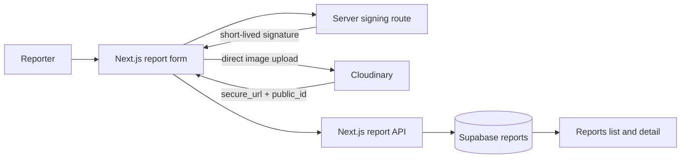

# EcoSnap | Hacktober HackDays 2026 — Project Documentation & Build Journey

## Executive summary

EcoSnap is an image-first campus waste reporting service. Students submit a clear photo, category, location, severity and description. Facilities teams get evidence-rich reports rather than vague messages.

## Architecture

## Cloudinary lifecycle

1. The browser checks MIME type and an 8 MB limit.
2. It requests a signed upload from `/api/cloudinary/sign`.
3. The server uses `CLOUDINARY_API_SECRET` only to make a SHA-1 signature; it never sends the secret to the browser.
4. The browser uploads directly to Cloudinary and receives `secure_url` and `public_id`.
5. Schema validation requires both fields before a report can be persisted.

## Setup and verified checks

Copy `.env.example` to `.env.local`, add Cloudinary credentials and (for persistence) Supabase URL/anon key. Run the SQL migration under `supabase/migrations` before adding Supabase variables.

On 18 October 2026, `npm run typecheck` and `npm run build` completed successfully. The unauthenticated Cloudinary-sign endpoint was also checked and correctly returned a safe configuration error. A real upload and Supabase write cannot be asserted until account credentials are supplied.

## Demo path

Open `/report`, upload an image, enter a title/location/details, submit, then open `/reports` and the created detail route. With Supabase configured these are shared persisted records; otherwise the app explicitly uses browser-local demonstration storage.

## Known limits and next steps

Admin authentication requires a configured Supabase Auth project and approved administrator identities. Add this before exposing status updates. Deploy after adding equivalent production environment variables; then run the above demo against the live URL.
